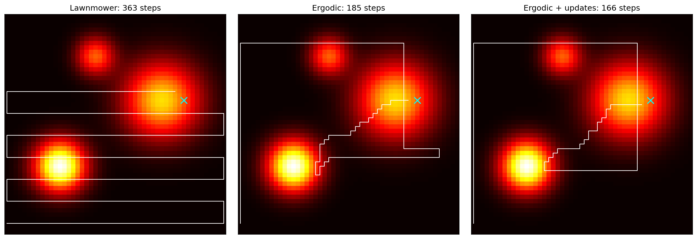
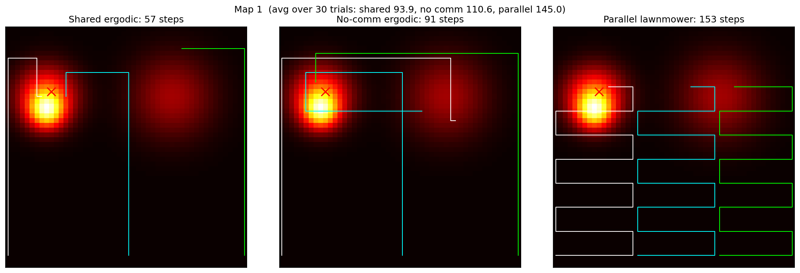
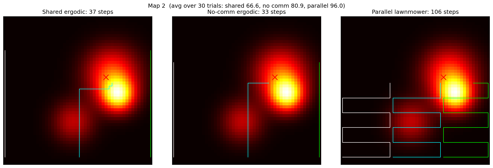
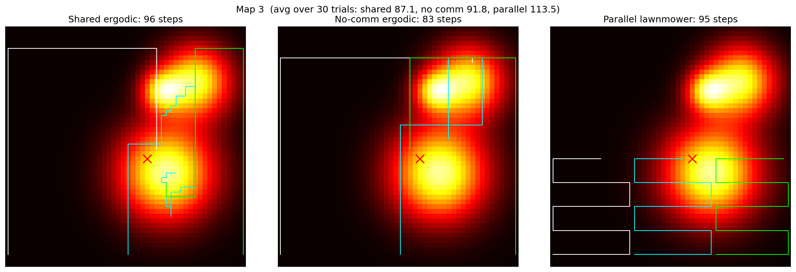

# SAR Search Simulator

A Python simulator comparing search strategies for drones looking for a missing person, based on a probability map of where they are likely to be.

## Strategies

- **Lawnmower:** sweeps the grid row by row. Ignores the probability map.
- **Ergodic:** greedy planner that picks each move to minimize the Fourier-based ergodic metric, so the time the drone spends in each region matches the probability of the person being there.
- **Ergodic + Bayesian updates:** same planner, but every area the drone searches without finding the person is set to zero probability and the map is renormalized, so the drone stops re-searching places it already checked.

## Setup

- 50x50 grid, probability map built from 3 Gaussian hotspots
- Drones see a 5x5 area around themselves and move one cell per step
- All strategies start from the same positions and face the same target locations

## Single drone results



20 random maps, 50 trials each:

| Strategy | Avg steps to find person |
|---|---|
| Lawnmower | 274.2 |
| Ergodic | 316.2 |
| Ergodic + updates | **191.0** |

Ergodic + updates beat lawnmower on 16 of 20 maps (about 30% fewer steps). Plain ergodic beat lawnmower on only 6 of 20.

**Observations**

- Plain ergodic search optimizes coverage, not detection, so it keeps returning to hotspots it has already searched.
- Adding Bayesian map updates fixes this and makes ergodic the best strategy on most maps.
- Lawnmower's wins came on maps where the hotspots happened to be near its starting rows.

## Multi-drone: shared map vs. no communication vs. parallel lawnmower

Three drones per setup.

- **Shared-map ergodic:** one probability map and one combined visit history. When one drone searches an area, the others know, and the ergodic metric is computed on the team's combined coverage.
- **No-communication ergodic:** each drone has its own map and only crosses off what it saw itself. Drones cannot see each other.
- **Parallel lawnmower:** the map is split into three vertical strips and each drone sweeps its own strip. A standard SAR pattern with no overlap, but it ignores the probability map.

10 random maps, 30 trials each:

| Setup | Avg steps to find person |
|---|---|
| Shared-map ergodic | **72.9** |
| No-communication ergodic | 87.0 |
| Parallel lawnmower | 111.7 |

Shared-map ergodic beat no-communication on 9 of 10 maps (about 16% fewer steps) and beat parallel lawnmower on 9 of 10 (about 35% fewer). Even without communication, ergodic search beat parallel lawnmower, so using the probability map mattered more than dividing up the area. Without sharing, ergodic drones get pulled toward the same hotspots and duplicate coverage. Three drones with a shared map found the person about 2.6x faster than a single drone.

Each image shows shared ergodic, no-communication ergodic, and parallel lawnmower on the same map and target:





All 10 maps are in [`multi_maps/`](multi_maps/).

## Limitations

- **Greedy planning:** one step at a time instead of full trajectory optimization. The planner tends to hug the map edges, likely because the cosine basis functions are largest at the boundaries and a one-step lookahead favors those moves.
- **Simple motion:** one grid cell per step instead of real vehicle dynamics.
- **Stationary target:** in open water a person would drift, which would need a prediction step that moves the probability map before each update.
- **Perfect sensor:** if the person is in view, they are always detected.
- **Communication extremes only:** perfect sharing vs. none, with no range limits or delays in between.

## Files

- `world.py`: probability map and target sampling
- `search.py`: lawnmower path and detection
- `ergodic.py`: ergodic metric and single-drone ergodic search
- `experiments.py`: single-drone comparison across 20 random maps
- `compare_paths.py`: side-by-side paths for all three strategies
- `multi.py`: multi-drone search with and without a shared map, saves one image per map to `multi_maps/`

## Run

```
pip install numpy matplotlib
python experiments.py
python compare_paths.py
python multi.py
```
